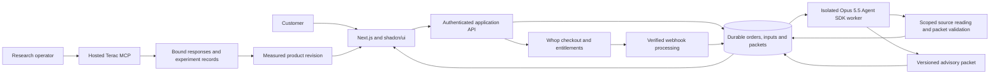

# Architecture — purchase, prepare, deliver, learn

## Reuse the existing application

Base inspection: Caid commit `53512822b2c56fb25ae2457ed426e6b9774886b9`. Recheck the actual checkout before edits.

| Existing area | Narrow use |
| --- | --- |
| app/changes and lib/changes | Reuse request/evidence/review contracts, authentication and version checks where appropriate |
| lib/changes/store.ts | Preserve existing transactional revision behavior; add separate order/packet persistence |
| lib/forma-inference.ts and server provider selection | Extend or bridge to verified Opus 5.5 runtime; Anthropic was not an existing option at inspection |
| lib/agent-engine.ts | Reuse protected-reference ideas; replace fixture-only matching for the paid packet path |
| product_pipeline/schema.py and validate.py | Retain for applicable Product changes; do not require unrelated geometry validation for a text packet |
| graph/CAD/scanner/demo | Preserve source and legacy access where safe; exclude from the paid demo's critical path |

Do not make graph synchronization or a full enterprise migration a prerequisite for delivering a review packet. Do not alter the existing evidence gates merely to finish a paid order. [Caid source](https://github.com/deanhu0822/caid-labs/tree/53512822b2c56fb25ae2457ed426e6b9774886b9).

## Topology

One web service and one bounded worker are sufficient. Use a persisted database job table and worker leases initially; do not add a distributed orchestration stack without a demonstrated need. A paid order is fulfilled only by a persisted packet version with valid source bindings.

## Separate state machines

**Commerce:** draft order → checkout pending → paid, canceled or failed; later refunded/access revoked when confirmed by the provider. State comes from verified server-side Whop data, not a redirect URL or client flag.

**Fulfillment:** not queued → queued → running → needs input, ready, failed or canceled. Every transition has a persisted receipt. Retry uses the same order entitlement and creates a traceable run attempt; it cannot charge twice or overwrite a delivered packet.

**Engineering:** preserve the existing draft → in review → changes requested/saved semantics. Packet delivery never changes engineering status or product head. Turning a packet into a proposed change is an explicit authorized action using expected versions; all original approval gates apply.

**Research:** prepared → quoted → authorized → launched → responses received → analyzed → improvement shipped → follow-up measured. Keep synthetic replay in a separate namespace. A completed provider status without actual response content cannot advance to analyzed.

## Minimum data model

| Record | Required boundary |
| --- | --- |
| Account/customer | Server-authenticated identity; ownership of orders and packets |
| RequestVersion | Goal, J12 scope, baseline/unknowns, sector snapshot, original text and manifest digest |
| SourceArtifact | Immutable bytes/text, supplied revision, hash, source ID and exact excerpt anchors |
| Order | Customer, request version, Whop business/product/checkout references, currency/amount and verified payment state |
| Entitlement | Order-specific access and fulfillment rights; no engineering reviewer authority |
| PaymentEvent | Provider event ID, verification result, processing timestamp and deduplication state |
| AgentRun | Order/request binding, source digest, requested/effective settings, attempt, lease, budget and terminal status |
| PacketVersion | Immutable content, structured claims, source mappings, limitations and validation receipt |
| Clarification | Authorized packet-bound question, cited answer, limits and usage |
| ResearchStudy/Response | Provider IDs, reviewed study definition, exact tested version, pseudonymous participant ID, response provenance and timestamps |
| Experiment | Frozen rubric, baseline/follow-up counts and metrics, change diff, analysis limitations |

Use customer-scoped queries and unique constraints for payment events and fulfillment identity. Never attach a packet using an email string supplied by a model. Do not expose research participant identities or private customer sources in a public repo or demo.

## Payment integrity

Pin the actual Whop SDK/API version. Verify webhook signatures using the provider-supported method and raw body where required. Deduplicate events and reconcile delayed/out-of-order updates against authoritative provider state. Confirm expected business, order mapping, product, amount/currency and entitlement before fulfillment. Checkout redirect success is not proof of payment.

Test duplicate success, pending payment, invalid signature, wrong business, refund/revocation and concurrent worker claims. Paid retries do not create new charges. Public sample access is an explicit synthetic path, never a universal payment bypass. Server-side authorization applies to downloads, source excerpts, run events and clarification.

## Agent boundary

Use one Claude Agent SDK worker with Claude Opus 5.5, adaptive, bounded effort, and verified effective context capacity. Cursor uses Fable 5.1 at 1M/High only for building the project. Isolate its directory/configuration. Scope tools to reading the frozen order's sources, checking citations/schema and persisting an advisory packet. No payment/refund, recruitment launch, outbound message, hardware approval or revision-commit tools. Tool handlers enforce ownership independently of model text and SDK permissions.

Validate every citation resolves to the same source version and the claimed excerpt. Mark inference, conflict and absence explicitly. At most one structural repair attempt before a readable failure/partial result. Bound clarification to the purchased version and configured usage. Persist cancellation and prevent further tool calls after it is observed. A crash/retry cannot produce duplicate fulfillment or mutate an existing packet.

## Terac integration

Use hosted Terac MCP and discover actual schemas/account access. The reviewed cookbook provides useful lifecycle/binding examples; its default is synthetic replay and its current live adapters do not retrieve substantive feedback. Do not embed its plaintext single-owner checkpoints as production concurrent storage. Implement/verify the hosted response-retrieval path and bind all responses to the precise study and packet presentation version.

Prepare launch definition, audience, public synthetic URLs, quote, sample count and spend cap for explicit approval before committing paid recruitment unless those exact actions are already authorized. Reconcile uncertain launch outcomes before retrying. Do not use customer documents in the study. Source: [cookbook access](https://github.com/TeracAI/terac-cookbook/blob/77b3473c7437a480fd639d38a2a40b6b6226d246/docs/terac-access.md).

## Deployment

Use one persistent Node host with durable SQLite and the worker for the pilot if supported by the actual deployment target. Back up and restore using supported database procedures. The inspected Caid implementation deliberately disables its durable workflow on Vercel. Never remove that guard or place live orders on ephemeral disk. If the selected deployment is serverless/multi-instance, migrate the required store to a managed transactional database and prove concurrency parity first.

Host only isolated synthetic sample assets publicly. Customer inputs, source excerpts and packet downloads are authenticated. Recheck access on all inherited routes that might expose actual data. Do not claim enterprise tenancy or production readiness from the pilot account implementation. Record real deployment constraints and any missing credentials honestly.
